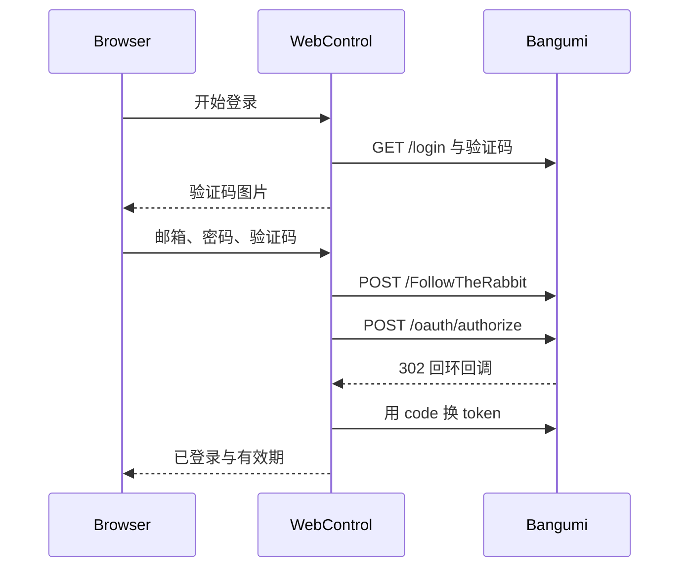

# 技术方案

## 架构

网页浏览器只访问电视上的 Web Control。电视用已有出站代理访问 `bgm.tv`：先取登录页 `formhash` 和 `/signup/captcha`，再把邮箱、密码、验证码 POST 到 `/FollowTheRabbit`。登录成功后，同一 cookie 会话提交 OAuth 授权表单。Bangumi 302 到已注册的 `http://127.0.0.1:13712/callback` 时，电视不跟随这次跳转，而是把回调交给现有的 `BangumiOAuthCoordinator` 换 token。

## 接口

- `POST /api/metadata/bangumi-login/start`：开始一次登录，返回 `challenge` 和 `captchaImage`（data URL）。未配置 OAuth 应用时返回 `not_configured`。
- `POST /api/metadata/bangumi-login/captcha`：同一会话换验证码。
- `POST /api/metadata/bangumi-login`：正文为 `email`、`password`、`captcha`。成功为 `success`，验证码错误为 `challenge` 加新图片，其余失败为 `failed`。
- `POST /api/metadata/bangumi-login/cancel`：放弃未完成的授权。
- 响应不包含密码，也不回显 access token。`GET /api/metadata` 增加 `bangumiTokenExpiresAtMillis`，没有有效期时为 0。

## 安全

密码只进入当次发往 Bangumi 的表单，不写入 `AppCredentialStore`，也不出现在响应或固定错误文案里。会话最多保留 10 分钟。Web Control 原有访问令牌仍然保护这些接口。

## 测试

`BangumiPasswordLoginClient` 用 MockWebServer 固定 Bangumi 的 HTML。`BangumiWebConsoleLogin` 用假的登录客户端和现有 OAuth coordinator 验证换 token、重试、过期和空字段。路由测试确认响应体不含密码。
